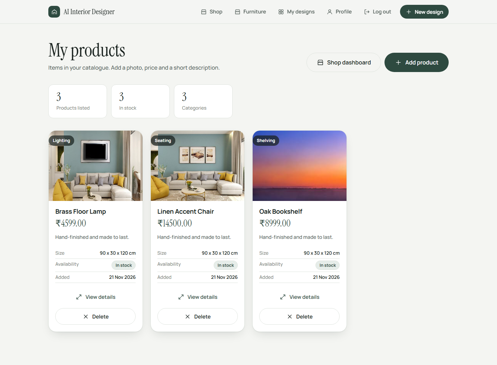
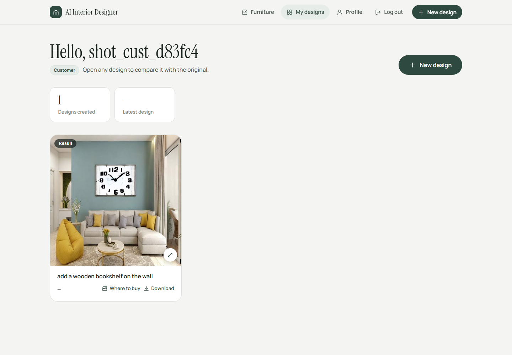
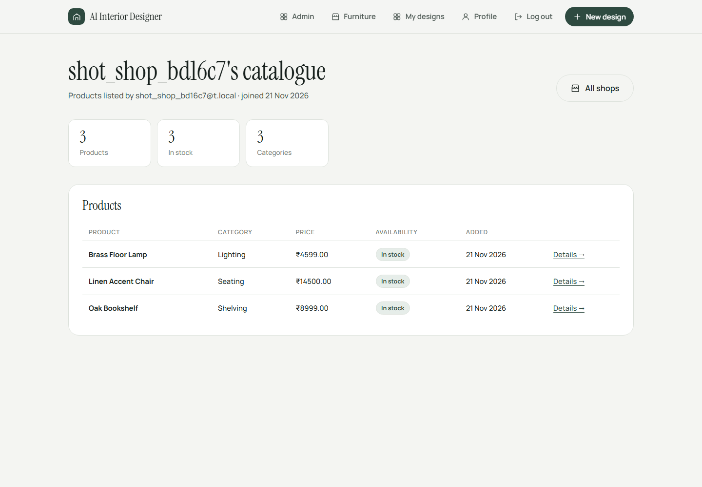

# AI Interior Designer

A Flask app that turns a photo of a room into a design preview with local
Stable Diffusion inpainting, then suggests nearby shops using Gemini. It also
includes role-based dashboards, a shop-owner product catalogue and drag-and-drop
furniture placement.

**Repository:** https://github.com/varunhunakunti2-crypto/EDITOR_CODE_updated

## Quick start
    git clone https://github.com/varunhunakunti2-crypto/EDITOR_CODE_updated.git
    cd EDITOR_CODE_updated
    python -m venv .venv && .venv\Scripts\activate      # Windows
    pip install -r requirements.txt
    copy .env.example .env                              # then edit the values
    python app.py        # open http://localhost:5000 (use localhost — the microphone needs it)

On macOS/Linux use `source .venv/bin/activate` and `cp .env.example .env`.
The first design request downloads the inpainting model (a few GB) and loads it
in the background; `/model-status` reports progress.

## Settings (.env)

Copy `.env.example` to `.env` and fill in your values. `.env` is gitignored; only
the placeholder template is committed.

- `SECRET_KEY` — Flask session secret; use a long random string.
- `GEMINI_API_KEY`, `GEMINI_MODEL`, `GEMINI_TIMEOUT` — nearby-shop suggestions. The default model is `gemini-3.5-flash-lite` (fast, ~2s); if it fails the app tries `gemini-3.5-flash` then `gemini-flash-latest`.
- `SD_MODEL_ID`, `SD_DEVICE` — local inpainting, described below.
- `REPLICATE_API_TOKEN` — optional, only used by the standalone `code1_api.py` example; the Flask app does not call Replicate.

The local inpainting model is configured with SD_MODEL_ID (default `runwayml/stable-diffusion-inpainting`, a public repo — the old `stabilityai/stable-diffusion-2-inpainting` now returns 401) and SD_DEVICE (`auto`, `cuda` or `cpu`). It is downloaded on first use; startup does not block. Check `/model-status` to see whether it is loading, ready, or what error occurred. A failed load is retried on the next design request.

## Roles and dashboards
Sign-up lets a user choose Customer, Interior designer or Shop owner. The first account created automatically becomes Admin (admin cannot be self-selected). Each role has its own landing page:

- Admin → `/admin` — user/role counts, account list and recent designs
- Customer / Interior designer → `/dashboard` — the design workspace
- Shop owner → `/shop` — storefront home with catalogue links and product count

Routes are protected by role; admins may open every dashboard. Existing accounts are migrated to `customer` automatically.

## Shop owner product catalogue
Shop owners can build a real product catalogue:

- `/shop/products` — product grid with counts, availability badges and delete actions
- `/shop/products/add` — multipart upload form for name, category, price, dimensions, availability, description and a PNG/JPG/JPEG image (max 16 MB)
- Images are stored in `static/uploads/products/`; deleting a product removes both its row and its image file

Each shop owner sees only their own products; admins can open every catalogue. Customers/designers are redirected away from all product routes.

## Drag-and-drop furniture placement
The result page (`/design/<id>`) has a "Place furniture" panel:

- Drag catalogue items from the palette onto the result image, or click an item to drop it in the centre
- Drop an image file from your desktop, or use "Your image" in the palette
- Drag placed items to move them; scroll over an item to resize; use × to remove one; Clear removes all
- "Download design" flattens the arranged items onto the original result and saves a PNG

Placement is a client-side preview — it is not saved to the design record.

## Admin lists and product details
- `/admin/users` — full user list with roles, design/product counts and shop links
- `/admin/shops` — shop owners with product/in-stock counts; `/admin/shops/<owner_id>` opens one shop's catalogue
- `/products` — furniture catalogue for any logged-in user; `/products/<product_id>` shows full details (price, category, dimensions, availability, description, seller) with a "Place in my design" shortcut

Admin list routes are role-protected; non-admins are redirected to their dashboard.

## New features
- Voice or typed prompt: mic button records in the browser, the server transcribes it with SpeechRecognition (Google web recognizer, needs internet).
- Nine placement buttons (top/middle/bottom x left/centre/right). The chosen spot becomes the white inpainting mask, so only that area is edited.
- Enter a city/area (or "Use my location") and Gemini suggests nearby stores for the item, shown on the result page with Google Maps links.
- Old databases are upgraded automatically with the new columns.

## Project layout

- `app.py` — routes, role guards, Gemini integration and lazy AI model loading
- `database.py` — SQLAlchemy models and automatic schema upgrades
- `templates/`, `static/` — UI, styles and client-side placement (`static/JS/placement.js`)
- `tests/` — smoke suite and Playwright browser/screenshot suite
- `docs/screenshots/` — generated UI captures
- `instance/interior_design.db` — local SQLite data, created automatically and not committed
- `.env` / `.env.example` — local secrets / safe template

Generated uploads (`uploads/`, `static/uploads/`) and Python caches are also
gitignored.

## Testing

Start the app first (`python app.py`), then run the suites from the project folder:

    python tests/smoke_test.py       # 41 HTTP/DB checks, standard library only
    python tests/browser_check.py    # 12 real-browser checks + screenshot generator

`smoke_test.py` verifies public pages, role-based redirects and guards for all four
roles, product upload/list/detail/delete, catalogue access, admin lists and file
cleanup. `browser_check.py` uses Playwright + Chromium to render every screen,
exercise drag-and-drop placement, check for console errors and failed requests,
and regenerate the screenshots below.

    pip install playwright && python -m playwright install chromium

Both suites create temporary demo accounts, products and a design, then delete
them (and their uploaded images) when they finish, leaving existing data intact.
Older rows with a NULL `created_at` are rendered safely via the `date` template
filter and backfilled by `upgrade_schema()` on startup.

## Screenshots

Generated by `tests/browser_check.py` into `docs/screenshots/`:

| Screen | Preview |
| --- | --- |
| Home |  |
| Register |  |
| Shop dashboard |  |
| Product list |  |
| Add product |  |
| Catalogue |  |
| Product detail |  |
| Result + placement |  |
| Customer dashboard |  |
| Admin dashboard |  |
| Admin users |  |
| Admin shops |  |
| Admin shop catalogue |  |
